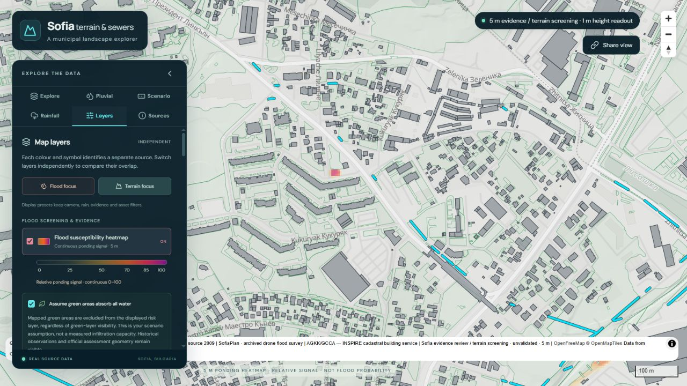
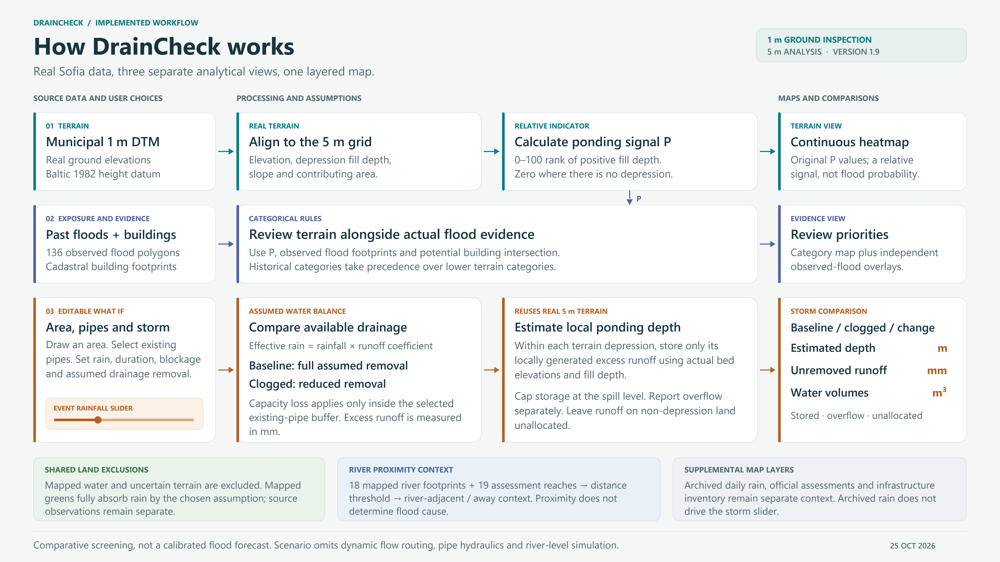

# DrainCheck

DrainCheck is an interactive map for exploring rainfall-related ponding in Sofia.
Compare terrain, sewer routes, buildings, green areas and flood observations,
then test how selected pipe blockages could change a rainfall scenario.

The map provides **relative flood-susceptibility screening and hypothetical
scenario comparisons**. Use the results to identify places for closer inspection;
they are not validated flood forecasts or drainage-design calculations.

## Open the app

**[Open the web demo](https://willing-platinum-tries-their.trycloudflare.com/)**

The free demo runs through a temporary Cloudflare Tunnel. Its hosting computer
must remain awake and online, with the app and tunnel running. The address
changes when the tunnel restarts.

For a configured local installation, double-click **Run_Sofia_App.cmd** and open
**http://127.0.0.1:8040**. Keep its terminal window open. To share that installation
through a new temporary HTTPS link, use **Run_Cloudflare_Demo.cmd**.
See the [installation guide](docs/INSTALLATION.md) for another computer and the
[demo guide](docs/CLOUDFLARE_TUNNEL_DEMO.md) for sharing and stopping the tunnel.

## How DrainCheck works

Follow the terrain-screening, flood-evidence review and rainfall/pipe-blockage
scenario paths in the diagram.

Open the [full-size image](docs/DrainCheck_System_Schematic.png),
[PDF](docs/DrainCheck_System_Schematic.pdf) or
[editable SVG](docs/DrainCheck_System_Schematic.svg).

## Start with the map

1. Open **Layers** and choose **Flood focus** to show the ponding heatmap over
   hillshade, with buildings and green areas available as separate layers.
2. Zoom to a neighbourhood. Click the map to inspect its ground elevation and
   screening values, or click a route or building to inspect its source details.
3. Enable **Past flood observations** or **Official flood assessment** to compare
   the terrain signal with independent evidence. Use **View survey coverage**
   to visit the mapped historical observations in northern Sofia.
4. Open **Scenario** to select pipes and compare rainfall and blockage assumptions.

The app initially opens in **Explore**, with elevation and hillshade visible.
Flood screening, historical overlays and rainfall are optional. On smaller
screens, expand the controls to reach the same sections.

| Section | Use it to |
|---|---|
| **Explore** | Filter sewer routes, read route statistics, inspect elevation and adjust elevation colours. |
| **Pluvial** | Choose the heatmap or categorical evidence review, inspect terrain indicators and compare exposure summaries. |
| **Scenario** | Select existing pipes, enter a storm and compare baseline and clogged conditions. |
| **Rainfall** | Display archived daily rainfall and station observations as supplemental context. |
| **Layers** | Switch map layers independently, adjust their presentation and use the Flood/Terrain focus presets. |
| **Sources** | Check source dates, coverage, interpretation and available source documents. |

## Understand the layers

| Layer | What it shows |
|---|---|
| **Flood susceptibility heatmap** | A continuous, relative ponding signal from 0–100. Warm colours indicate a stronger terrain signal; the score is neither a percentage probability nor a water depth. |
| **Refined evidence review · categorical** | Categories combining terrain signal, mapped historical flood footprints and potential building-footprint overlap. Historical footprints receive category priority. |
| **Past flood observations** | Blue boundaries around 136 surveyed flood footprints from 2021, concentrated in northern Sofia. Coverage is incomplete and individual flood mechanisms remain unknown. |
| **Official flood assessment** | Assessment areas, river reaches and identifiers. These describe assessment context rather than observed event boundaries. |
| **Ground elevation / Hillshade** | Ground heights and relief. Point readings use the municipal 1 m terrain grid; the flood-screening analysis grid is 5 m. |
| **Cadastral buildings** | Grey filled AGKK building footprints, visible from zoom 13. Click a building for its cadastral identifier and attributes. |
| **Green areas** | The mapped green polygons. Their visibility and the green-absorption assumption are separate controls. |
| **Sewer routes** | Existing routes in cyan, planned routes in dashed magenta and open channels in yellow. |
| **Daily rainfall / Stations** | Optional archived rainfall totals and station records, with their own legend and opacity. |

The city-scale building layer contains cadastral footprints. The separate
Digital Twin building source is currently unavailable; no building height is
inferred from floor counts or ground elevation.

### Green areas, water and missing data

**Assume green areas absorb all water** starts enabled. It excludes mapped
green areas from the displayed screening/evidence layer even when the green
polygons themselves are hidden. Turn it off to inspect the original terrain
screening within green areas. Historical observations and official assessment
geometry remain independently visible.

Pipe-blockage scenarios always apply full absorption to mapped green areas.
This is an assumption, not a measurement of infiltration capacity.

Existing mapped water is automatically excluded from land screening. Nearby
banks remain eligible. A transparent cell can mean a low signal, an excluded
area or missing coverage; use the inspector to distinguish these states.
Grey screening cells indicate uncertain terrain, not a low-risk class.

## Inspect terrain and sewer routes

In **Explore**, choose **Inside green**, **Outside** or **All routes**, then
select the route statuses to include. Statistics describe the full filtered
dataset, not just the visible map. **Export selected sections** downloads those
filtered route sections.

A route can have both inside and outside sections, so their route counts do
not add. All mapped green polygons contribute to this split, including when
their display is hidden or a smaller display subset is selected.

**Fit this view** adjusts elevation colours to the current area. Those colours
stay locked as you move; **Reset** restores the whole-study-area scale.
**Auto-fit after moving** is optional. These controls change the elevation
display only: ground heights and flood-screening values stay fixed. The 1 m
terrain resolution describes grid spacing, not guaranteed vertical accuracy.
Elevation readouts are in metres in the Baltic 1982 height datum.

## Compare a pipe-blockage scenario

1. Open **Scenario**, choose **Draw pipe selection area**, and drag a rectangle
   on the map. An initial calculation selects intersecting existing routes.
2. Review **Choose existing pipes**. Select individual routes, **Select all
   existing** or **Select none**. Planned routes and open channels remain context.
3. Set the storm and drainage assumptions below, then choose **Recalculate
   scenario**. Changing the rainfall slider recalculates automatically after
   a short pause; other edits require the button.
4. Under **Compare on map**, compare **baseline**, **clogged** and **additional**
   estimated ponding depth in metres, or unremoved runoff in millimetres.
5. Download **Scenario GeoTIFF · all bands** and **Scenario record · JSON** to
   retain the outputs, selected pipe IDs and assumptions.

| Assumption | Initial value | Meaning |
|---|---|---|
| Storm rainfall | 30 mm | Total rain for the event being tested. |
| Duration | 60 minutes | Time over which the assumed drainage removal operates. |
| Drainage removal | 15 mm/hour | Assumed area-equivalent removal rate, not measured pipe capacity. |
| Blockage | 100% | Loss of that assumed removal around selected existing pipes. |
| Pipe influence distance | 50 m | Buffered neighbourhood around selected routes, not a measured drainage catchment. |
| Runoff coefficient | 0.9 | Fraction of rainfall counted as runoff on eligible land. |
| River proximity | 100 m | Threshold for the separate river-context view. |

The calculation compares runoff with assumed drainage removal. Blockage reduces
removal within the selected pipes' influence area; overlapping buffers count
once. Actual terrain elevations and depression storage then provide a bounded
local ponding-depth estimate. Water is not routed through a connected sewer
network or across the whole city, and overflow can remain unallocated.

The warm scenario heatmap replaces the terrain-screening raster while
**Show scenario result layer** is enabled. Its cool blue selection area, pipe
highlights, grey buildings, green areas and evidence layers can remain visible
together. Hide the scenario result to restore your previous terrain-screening
choice. Choose **Flood focus** to enable the terrain heatmap.

**River proximity view** filters the displayed scenario cells. It does not
change the full-selection totals or downloads. Proximity can indicate possible
mixed influences; it does not establish whether a flood was pluvial or river-driven.

Selections are limited to **25 km²** and **1,000,000 analysis cells**. Draw a
smaller or more compact area if either limit is reached. The app does not
diagnose which pipes are currently clogged.

## Use rainfall and historical evidence

The **Rainfall** section contains daily accumulated rainfall for **27 June
2025**: merged radar and stations, bias-corrected radar, and raw radar. Rainfall
starts hidden and uses 30% opacity when enabled. Accepted and rejected station
records can be displayed separately.

This daily rainfall layer is supplemental. It does not change the terrain score
or automatically set the storm amount in **Scenario**. Daily totals do not
resolve short-duration storm intensity. Product coverage differs; check its
coverage and missing-data state before comparing an area.

For past flooding, use **Show mapped flood observations**, **Flood mechanism**
and **Mechanism certainty**. **Prioritise historical evidence visually**
strengthens the blue styling without adding points to a terrain score.
Unclassified footprints remain unknown when filtered. Official flood maps and
the event register are available under **Sources**; textual incident records
are not presented as precise mapped flood extents.

## Share and download

**Share view** copies the map position, layer choices, filters, elevation colour
scale and rainfall-display settings. A fitted local colour scale also requires
the same server to retain that scale.

**A shared map URL does not save the drawn scenario area, pipe selections,
storm assumptions or scenario result.** Download the scenario JSON and GeoTIFF
to keep a calculation. The GeoTIFF contains six bands: baseline, clogged and
additional runoff, followed by their three estimated ponding-depth fields.

Route exports, screening downloads, source records and reports are available
from their relevant panels. Check the selected mode, units and source date
before comparing downloads.

## Interpret results

The default heatmap ranks geometric ponding potential relative to the terrain
reference area. The categorical review adds evidence and potential footprint
exposure as categories. Scenario maps test entered rainfall and drainage
assumptions. These are separate outputs with different units and meanings.

Layers represent different dates and coverage. Sewer routes describe a 2009
inventory, green areas a 2020 source, historical survey footprints 2021, and the
daily rainfall event 2025. Mapped inventory does not establish current operating
condition. Building footprints provide context and potential overlap, rather
than simulated flow barriers or predicted damage.

The experimental combined-terrain and runoff-concentration modes remain
available under **Pluvial**. Their known grid/routing patterns require cautious
interpretation. A low score, missing flood observation or excluded cell does
not establish safety.

For equations, data definitions, worked examples and model limits, read the
**[risk calculation guide](docs/RISK_CALCULATION_GUIDE.md)** or its
**[PDF edition](docs/DrainCheck_Risk_Calculation_Guide.pdf)**.
